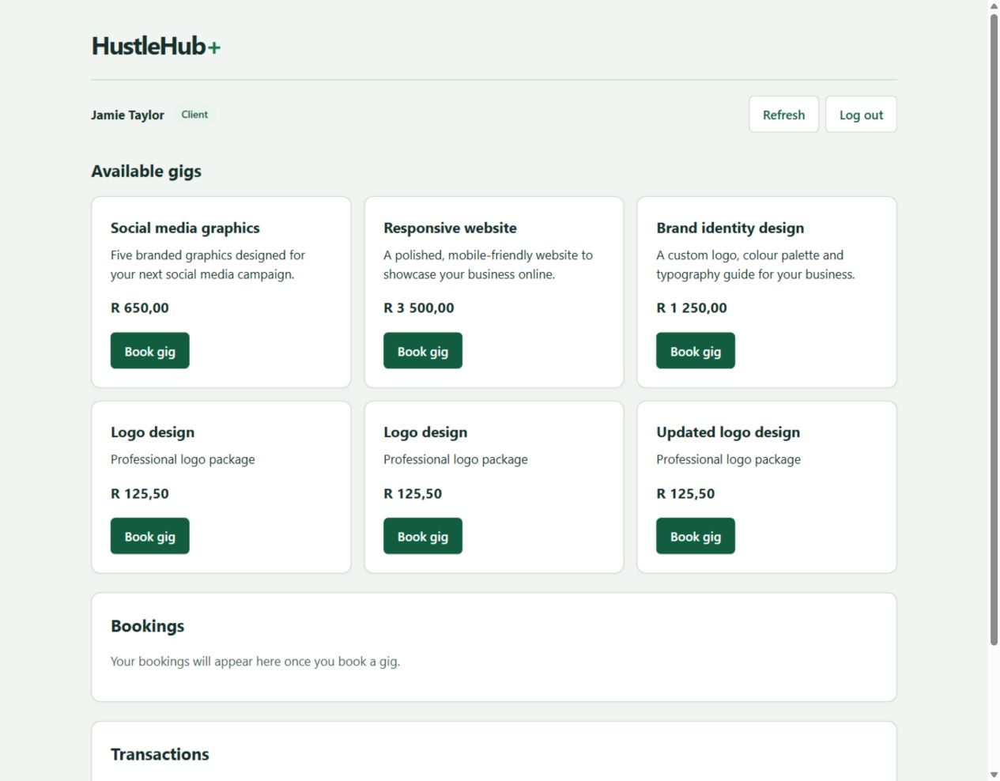
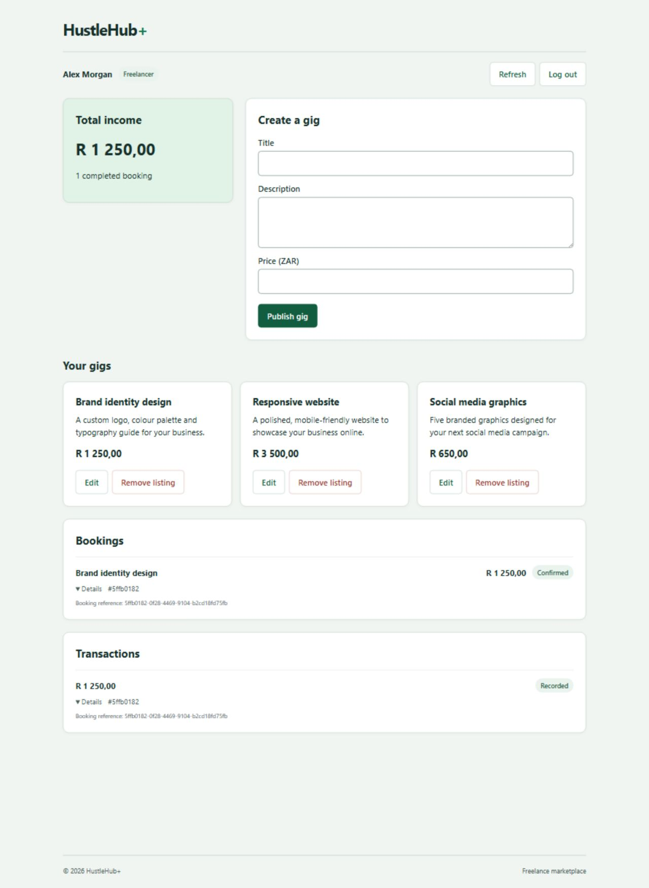
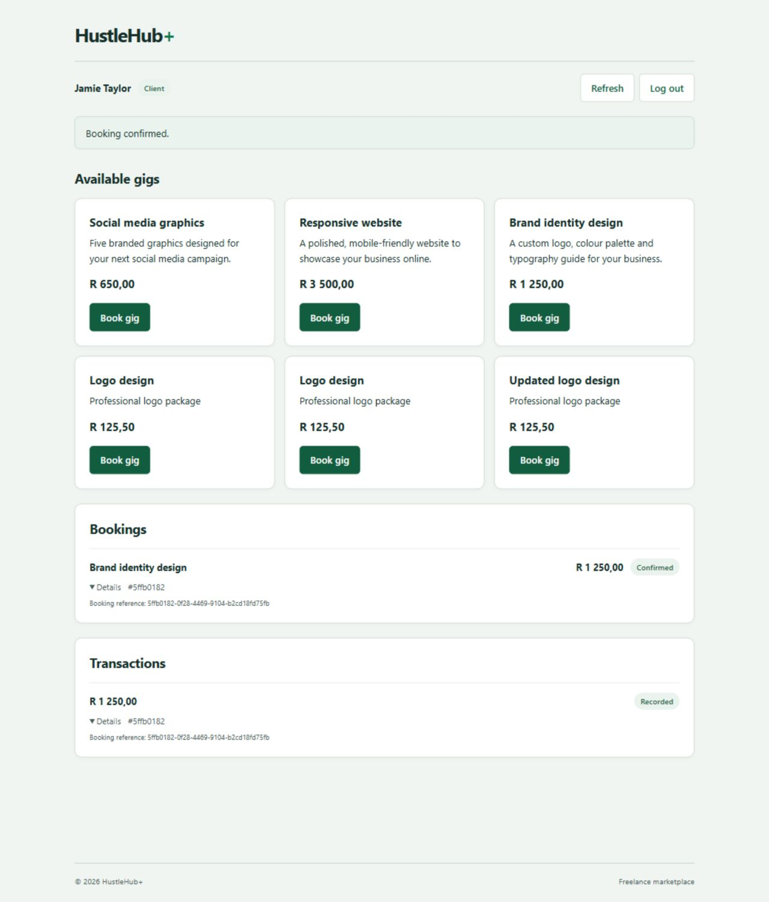
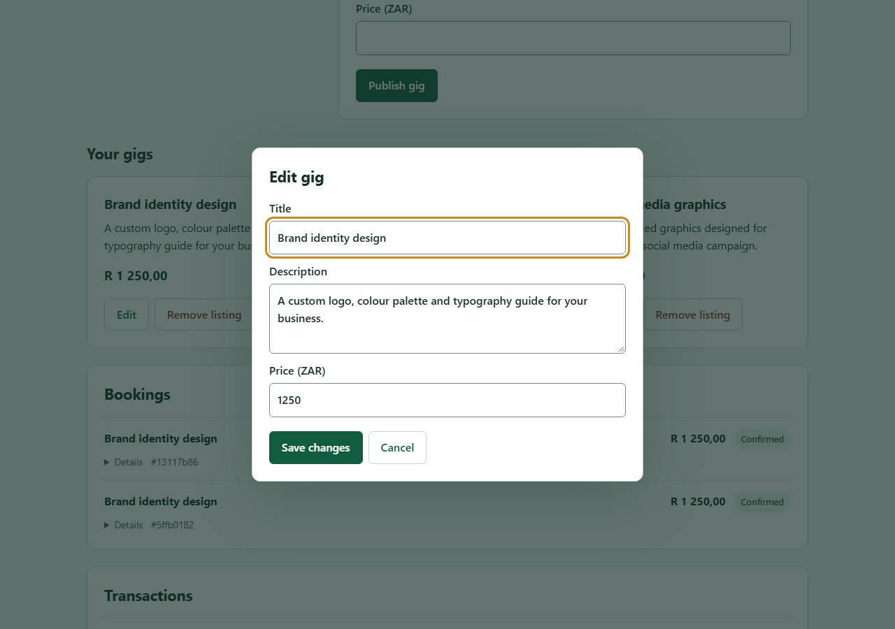
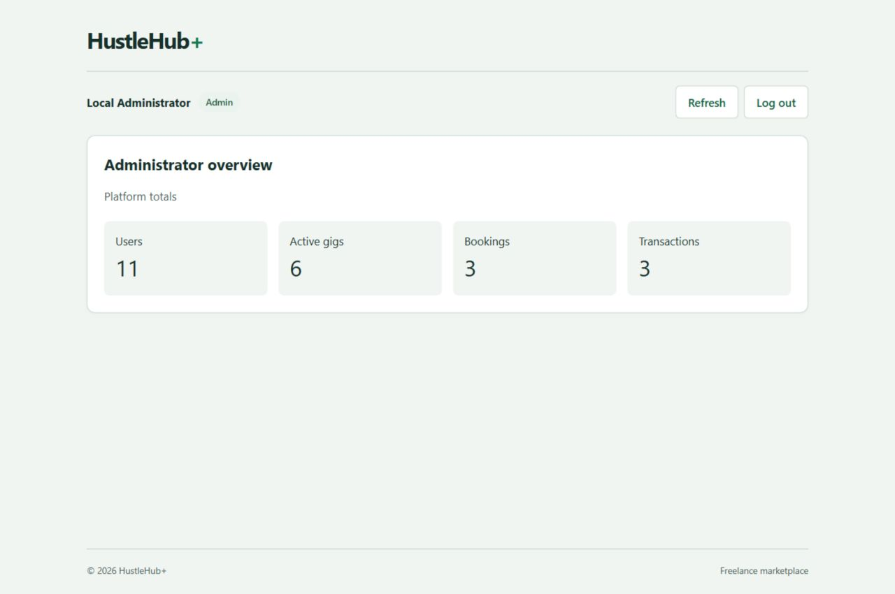
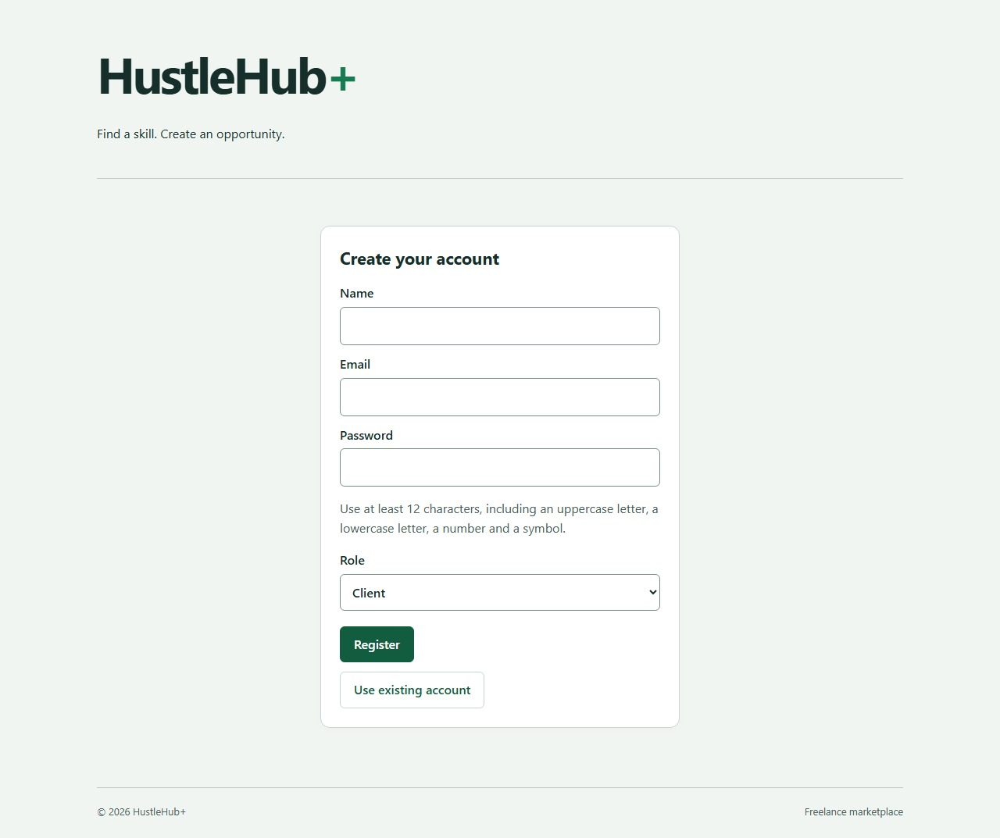
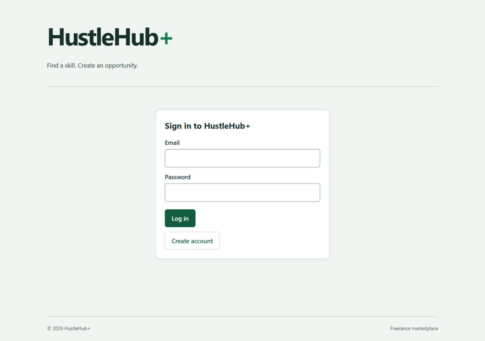
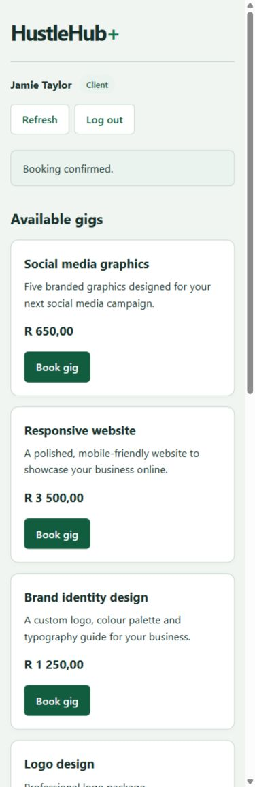
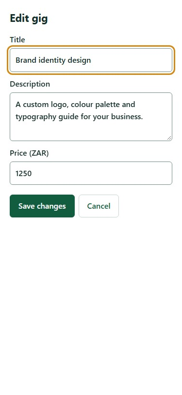

# HustleHub+

A full-stack freelance marketplace built with React, Express and MongoDB. Clients browse and book services, freelancers manage gigs and view income, and administrators access a system overview. Developed as a group academic project and adapted for this portfolio.

Payments and tax estimates are simulated for demonstration.

## Features

- Client and freelancer registration, JWT authentication, account lockout and token revocation on logout.
- Gig creation, editing and deactivation with role and ownership checks.
- Booking and transaction history, with server-derived prices, atomic database transactions and idempotent booking requests.
- Freelancer income dashboard with annual and monthly totals and an educational tax estimate.
- Structured application logging with optional Grafana Cloud Loki forwarding.
- Automated backend, API and frontend checks, plus Docker Compose verification through GitHub Actions.

## Technology stack

| Area | Technologies |
| --- | --- |
| Frontend | React, Vite, CSS |
| Backend | Node.js, Express, Mongoose |
| Database | MongoDB replica set |
| Authentication | JWT, bcrypt |
| Testing | Node.js test runner, Vitest, Testing Library, Newman |
| Tooling | Docker Compose, ESLint, GitHub Actions |

## Architecture

The React client calls the Express API over HTTPS. Middleware validates requests, authentication and access before controllers interact with MongoDB. Booking and transaction creation use a database transaction and require a MongoDB replica set or Atlas.

Docker Compose runs the API, frontend and database together. The API publishes a loopback-only HTTPS port, serves frontend requests through the internal client container and connects to MongoDB on a private network. Logs go to the console, with optional forwarding to Grafana Cloud Loki.

## Screenshots

These captures show the academic version with demonstration data.

### Client marketplace



### Freelancer workspace



<details>
<summary>Booking, gig editing and administrator views</summary>







</details>

<details>
<summary>Registration, sign-in and mobile views</summary>









</details>

## Setup and running

### Prerequisites and dependencies

Use Git, PowerShell, Node.js 22.13 or later in the 22.x line, npm and Docker Desktop with Linux containers and Docker Compose. Run commands from the application repository root.

```powershell
npm.cmd ci
npm.cmd --prefix backend ci
npm.cmd --prefix client ci
```

On other systems, use `npm` instead of `npm.cmd`.

### HTTPS certificate

Generate a localhost development certificate and private key with OpenSSL:

```powershell
New-Item -ItemType Directory -Force backend/certs | Out-Null
& 'C:\Program Files\Git\usr\bin\openssl.exe' req -x509 -newkey rsa:2048 -sha256 -nodes -keyout 'backend/certs/localhost-key.pem' -out 'backend/certs/localhost-cert.pem' -days 30 -subj '/CN=localhost' -addext 'subjectAltName=DNS:localhost,IP:127.0.0.1,IP:::1'
```

Adjust the executable path when necessary. Verify and trust the public development certificate in the local operating-system certificate store. Never commit the private key or disable certificate validation globally.

### Compose configuration

The default Compose project name is `hustlehubplus`. Optional machine-specific settings can be placed in the Git-ignored `compose.override.yaml` file, which Docker Compose loads automatically.

Create `.env.compose` from `.env.compose.example` without overwriting an existing configuration:

```dotenv
APP_PORT=3443
MONGO_ROOT_PASSWORD={{RANDOM_MONGO_ROOT_PASSWORD}}
MONGO_APP_PASSWORD={{RANDOM_MONGO_APP_PASSWORD}}
JWT_SECRET={{RANDOM_JWT_SECRET}}
LOKI_HOST={{LOKI_HTTPS_BASE_URL}}
LOKI_USERNAME={{LOKI_NUMERIC_INSTANCE_ID}}
LOKI_PASSWORD={{LOKI_LOGS_WRITE_TOKEN}}
```

Generate a different value for each of the three secrets by running the following separately:

```powershell
node -e "console.log(require('node:crypto').randomBytes(48).toString('hex'))"
```

All three cloud logging settings may be blank for console-only local operation. Cloud forwarding requires all three settings. The `.env.compose` file is ignored by Git.

```powershell
docker compose --env-file .env.compose config --quiet
docker compose --env-file .env.compose up --build -d --wait --wait-timeout 180
docker compose --env-file .env.compose ps -a
```

Open **https://localhost:3443**. Check **https://localhost:3443/api/health**. The `api`, `client` and `mongo` services should be healthy. The setup services `mongo-key`, `mongo-init` and `tls-init` are expected to finish successfully rather than remain running.

The stack uses a dedicated `hustlehub_part3` database and persistent named volumes. It does not automatically import an existing Part 2 Atlas database. Changing passwords in the environment file does not rotate users already created inside an existing database volume.

### Administrator creation

In a root PowerShell terminal:

```powershell
$env:ADMIN_EMAIL = Read-Host 'Administrator email'
$credential = Get-Credential -UserName $env:ADMIN_EMAIL -Message 'Choose the administrator password'
$env:ADMIN_PASSWORD = $credential.GetNetworkCredential().Password
try {
    docker compose --env-file .env.compose exec -e ADMIN_EMAIL -e ADMIN_PASSWORD api npm run create-admin
    if ($LASTEXITCODE -ne 0) { throw 'Administrator creation failed.' }
}
finally {
    Remove-Item Env:ADMIN_EMAIL, Env:ADMIN_PASSWORD -ErrorAction SilentlyContinue
    Remove-Variable credential -ErrorAction SilentlyContinue
}
```

Clients and freelancers use normal registration. No default administrator password is published.

### Native alternative

For a native deployment, configure the private `backend/.env` with `MONGODB_URI`, `JWT_SECRET`, `PORT=3443`, `HOST=localhost`, `BCRYPT_ROUNDS=12`, `JWT_EXPIRES_IN=1h`, the two certificate paths and, when required, the three cloud logging settings. The database must support transactions.

Stop Compose first if it occupies port 3443, then run:

```powershell
npm.cmd --prefix backend run build
npm.cmd --prefix client run build
npm.cmd --prefix backend start
```

For native administrator creation, use the same temporary environment variables with `npm.cmd --prefix backend run create-admin`. The container verification suite separately checks the Compose deployment.

### Stop the stack

```powershell
docker compose --env-file .env.compose down
```

This preserves named volumes. Do not add `-v` unless intentionally deleting the disposable local data.

## Testing and static analysis

```powershell
npm.cmd run lint
npm.cmd --prefix backend run test:unit
npm.cmd --prefix backend test
npm.cmd --prefix client test
npm.cmd --prefix backend run build
npm.cmd --prefix client run build
```

ESLint checks backend, frontend and verification scripts with security rules and zero permitted warnings. API tests start an isolated MongoDB replica set and HTTPS server, execute marketplace and final-part Newman collections, and verify security behaviour. Frontend tests cover rendering, interaction and the financial dashboard.

With the disposable Compose stack running:

```powershell
npm.cmd run test:stack
```

This creates test records and restarts the local API to check persistence. Do not run it against production. Set `STACK_PORT` when using a non-default `APP_PORT`.

## Contributors

| Contributor | Contribution |
| --- | --- |
| Khayden Chetty | Persistent account lockout, token revocation and audit utility |
| Rivaan Kawulesar | Finance API, tax calculation, financial event logging and HTTPS integration |
| Stephane Nsengiyumva | Static analysis, verification suites, Docker Compose and GitHub Actions |
| Zenwyn Naicker | Financial dashboard, chart and table, frontend tests and final documentation |

Frameworks, libraries and adopted code patterns are acknowledged in [CODE_ATTRIBUTION.txt](CODE_ATTRIBUTION.txt).
